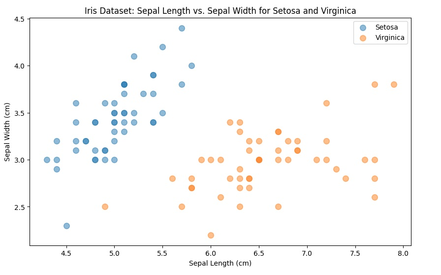
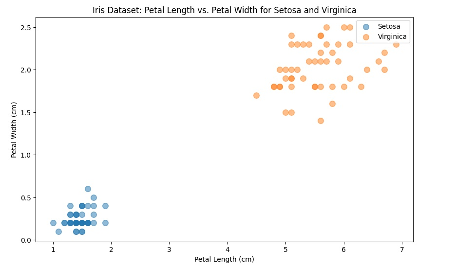

# Iris Dataset Exploration

An exploration of the classic Iris dataset, asking a simple question: can two species of iris be told apart with just two measurements — and which measurements do it best?

## The Dataset

The Iris dataset contains **150 samples** of iris flowers, each described by four measurements (in centimeters) and a species label:

| Feature | Meaning |
|---|---|
| Sepal Length | Length of the sepal |
| Sepal Width | Width of the sepal |
| Petal Length | Length of the petal |
| Petal Width | Width of the petal |

There are three species in the dataset:

| Class | Species |
|---|---|
| 0 | Iris setosa |
| 1 | Iris versicolor |
| 2 | Iris virginica |

This exploration focuses on **Setosa (class 0) vs. Virginica (class 2)**.

## What I Did

1. Loaded the dataset with scikit-learn (`datasets.load_iris()`).
2. Reduced the four dimensions to two at a time and visualized the two species with scatter plots (Matplotlib).
3. Compared the two feature pairs for how cleanly they separate the species.

## Findings

### Sepal Length vs. Sepal Width



Setosa and Virginica form a clear distinction with minimal overlap — a straight line could effectively separate them in this two-dimensional space, so simple linear classifiers should perform well using only these two features.

### Petal Length vs. Petal Width



The petal dimensions separate the species **even more clearly**: two distinct clusters with minimal overlap and a higher degree of linear separability. Petal length and petal width are the more effective features for distinguishing Setosa from Virginica, and a simple linear classifier using them should achieve high accuracy.

## Files

```
├── README.md                      # This file
├── iris_exploration.ipynb         # The full analysis notebook
├── plots/
│   ├── sepal_length_vs_width.jpg  # Sepal Length vs. Sepal Width (Setosa vs. Virginica)
│   └── petal_length_vs_width.jpg  # Petal Length vs. Petal Width (Setosa vs. Virginica)
└── report/
    └── Iris_Exploration_Report.pdf  # Notebook printout with code, plots, and discussion
```

## How to Run

```bash
pip install numpy scikit-learn matplotlib
jupyter notebook iris_exploration.ipynb
```

The notebook runs top to bottom with no extra data files — the dataset comes from scikit-learn.
